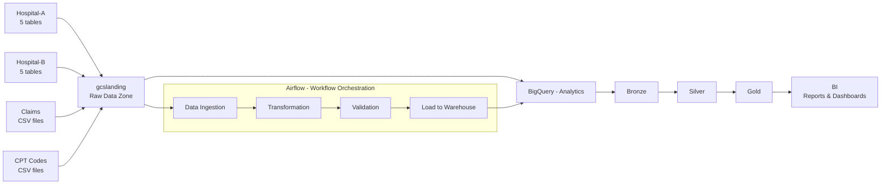

# Google Cloud Healthcare RCM Data Lake

A cloud-native healthcare analytics solution built on Google Cloud Platform (GCP) for Revenue Cycle Management (RCM). This project consolidates data from multiple hospital sources, transforms it into a common analytical model, and supports claims, billing, revenue, and operational reporting.

## Overview

This repository demonstrates an end-to-end healthcare data engineering and analytics workflow. It brings together data from multiple hospital systems and external healthcare reference files, then loads and processes the information into a modern data lake and analytics warehouse.

The project is designed to support:
- Patient and encounter analytics
- Claims and billing insights
- Department and provider reporting
- Procedure and CPT utilization analysis
- Revenue cycle monitoring
- Healthcare KPI dashboards

The architecture follows industry-standard data engineering practices, including metadata-driven ingestion, medallion layering, and scalable cloud-native processing.

## Business Problem

Healthcare organizations operate with data spread across multiple systems and formats. Typical sources include:
- Hospital EMR and operational data
- Claims files
- Provider and department master data
- CPT and billing reference tables

Without a unified architecture, it becomes difficult to:
- Track claim flows and reimbursements
- Monitor patient and encounter volume
- Measure provider productivity
- Analyze revenue performance
- Standardize data across hospitals

This solution enables centralized reporting and operational insight using GCP services.

## GCP Tech Stack

This project uses the following GCP services and tools:

- Google Cloud Storage (GCS): raw and staging data storage
- BigQuery: analytics and reporting warehouse
- Dataproc: Spark-based processing for ETL and transformations
- Cloud Composer (Apache Airflow): orchestration and pipeline automation
- Cloud SQL: operational and transactional data storage
- GitHub: source control and versioning
- Cloud Build: CI/CD automation
- IAM & Security: access control and governance
- BI / Reporting Tools: dashboards and insights

## Architecture

The project follows a layered data architecture, combining source files, GCS landing, transformation, BigQuery analytics, and business intelligence layers.



This architecture matches the project flow of:
- source hospital tables
- raw files in cloud storage
- bronze, silver, and gold processing stages
- final analytics in BigQuery
- BI dashboard consumption

## Project Structure

```text
Google-Cloud-Platform/
├── README.md
├── BigQuery/
│   └── DATASETS/
│       └── DP_BASE_TEMP.sql
├── Cloudsql/
│   ├── Hospital-a/
│   │   └── tables.sql
│   └── Hospital-b/
│       └── tables.sql
├── Data/
│   ├── claims/
│   │   ├── hospital1_claim_data.csv
│   │   └── hospital2_claim_data.csv
│   ├── configs/
│   │   └── load_config.csv
│   ├── cptcodes/
│   │   └── cptcodes.csv
│   ├── hospital-a/
│   │   ├── departments.csv
│   │   ├── encounters.csv
│   │   ├── patients.csv
│   │   ├── providers.csv
│   │   └── transactions.csv
│   └── hospital-b/
│       ├── departments.csv
│       ├── encounters.csv
│       ├── patients.csv
│       ├── providers.csv
│       └── transactions.csv
```

## Data Model

The project contains healthcare operational tables and reference data used for analytics. Core entities include:

- Departments
- Patients
- Providers
- Encounters
- Transactions
- Claims
- CPT codes

These tables support analysis across multiple dimensions, including:
- patient demographics
- hospital departments
- provider specialties
- encounter types
- procedure coding
- financial transactions and claims

## Key Design Principles

### Metadata-Driven Processing
The project uses configuration-driven load definitions to make ETL behavior reusable and easier to maintain.

### Slowly Changing Dimensions (SCD Type 2)
Historical changes to patient, provider, and transaction attributes are tracked to preserve business history.

### Common Data Model (CDM)
Data from multiple hospital sources is standardized to improve consistency and analytical reporting.

### Medallion Architecture
The solution uses a Bronze → Silver → Gold model:
- Bronze: raw ingestion layer
- Silver: cleaned and standardized layer
- Gold: curated, analysis-ready layer

### Logging, Monitoring, and Error Handling
Operational reliability is improved by tracking failures and capturing execution logs across the pipeline.

### CI/CD Automation
GitHub and Cloud Build enable consistent deployment and source management for the solution.

## Core Workflow

1. Source hospital data is collected and stored in raw formats.
2. Structured and semi-structured files are landed in GCS.
3. Source data is validated and processed through ETL pipelines.
4. Intermediate models are created in Bronze and Silver layers.
5. Gold-layer datasets are loaded into BigQuery.
6. Reporting and BI tools consume the curated data.
7. Metrics and dashboards monitor hospital performance and revenue indicators.

## Setup and Deployment Guide

### Prerequisites

Before deploying this project, ensure you have the following:

- A Google Cloud project
- Billing enabled on the GCP project
- Google Cloud SDK installed
- A valid service account with required IAM roles
- BigQuery, GCS, Dataproc, and Cloud Composer enabled
- Git installed
- Access to GitHub repository

### Required GCP APIs

Enable the following APIs:

```bash
gcloud services enable
  bigquery.googleapis.com \
  storage.googleapis.com \
  dataproc.googleapis.com \
  composer.googleapis.com \
  cloudbuild.googleapis.com \
  sqladmin.googleapis.com
```

### 1. Create a GCP Project

```bash
gcloud projects create <your-project-id>
```

Then set the active project:

```bash
gcloud config set project <your-project-id>
```

### 2. Configure Authentication

Authenticate with GCP:

```bash
gcloud auth login
gcloud auth application-default login
```

### 3. Create Cloud Storage Buckets

Create a landing bucket for raw healthcare files:

```bash
gsutil mb -p <your-project-id> -c STANDARD -l us-central1 gs://<your-project-bucket>
```

Recommended bucket structure:

```text
gs://<your-project-bucket>/
├── raw/
│   ├── hospital-a/
│   ├── hospital-b/
│   ├── claims/
│   └── cptcodes/
├── bronze/
├── silver/
├── gold/
└── config/
```

### 4. Create BigQuery Dataset

Create a dataset for analytics workloads:

```sql
CREATE SCHEMA IF NOT EXISTS DP_BASE_TEMP
OPTIONS (
  location = 'us-central1',
  description = 'Healthcare analytics dataset'
);
```

### 5. Create Cloud SQL Database

Use Cloud SQL to host transactional source tables if needed.

Example:

```bash
gcloud sql instances create healthcare-db \
  --database-version=MYSQL_8_0 \
  --tier=db-n1-standard-1 \
  --region=us-central1
```

Then create the database and load the schema from `Cloudsql/` files.

### 6. Upload Data Files

Upload the source files from the repository to GCS:

```bash
gsutil -m cp -r ./Data gs://<your-project-bucket>/raw/
```

### 7. Configure Airflow / Composer

Create or update a Cloud Composer environment and upload Airflow DAGs for ETL orchestration.

Example workflow:
- raw ingestion task
- schema validation task
- transformation task
- silver-layer processing task
- gold-layer aggregation task
- BigQuery load task
- monitor and alert task

### 8. Run Dataproc Jobs

Use Dataproc for Spark-based transformations when processing large healthcare files.

```bash
gcloud dataproc clusters create healthcare-cluster \
  --region us-central1 \
  --zone us-central1-a \
  --master-machine-type n1-standard-2 \
  --worker-machine-type n1-standard-2 \
  --num-workers 2
```

Then submit Spark jobs for cleansing and transformation.

### 9. Deploy via Cloud Build

If using CI/CD, add a `cloudbuild.yaml` file pipeline for automated deployment. Typical stages include:
- repository checkout
- validation and lint checks
- infrastructure provisioning
- data pipeline deployment
- DAG validation
- publish artifacts

Example structure:

```yaml
steps:
  - name: 'gcr.io/cloud-builders/gcloud'
    args: ['services','enable','bigquery.googleapis.com']
  - name: 'gcr.io/cloud-builders/gcloud'
    args: ['storage','ls']
```

### 10. Validate the Deployment

After deployment, validate that:
- source files are available in GCS
- BigQuery tables are created
- data loads successfully into Bronze/Silver/Gold layers
- Airflow DAGs are running
- Spark jobs complete without errors
- dashboards connect to the correct datasets

## Data Processing Flow

The workflow is structured as follows:

1. Load raw files from `Data/` into the landing zone.
2. Validate schema and file integrity.
3. Apply transformations to standardize fields and remove duplicates.
4. Enrich the data with business logic.
5. Create Bronze-Silver-Gold datasets.
6. Load the curated model into BigQuery.
7. Use reporting tools to build dashboards and KPI views.

## Suggested Healthcare KPIs

The analytics layer can be used to generate metrics such as:
- Total encounters by hospital
- Total claims by payment status
- Average claims amount
- Paid vs unpaid claims
- Provider specialty productivity
- Department volume analysis
- Procedure utilization trends
- Monthly revenue cycle insights

## Security and Compliance

Because this is healthcare data, security and governance are critical.

Recommended practices:
- use least-privilege IAM access
- restrict access to sensitive patient and billing data
- encrypt data at rest and in transit
- use private networking where possible
- audit data access with Cloud Logging
- maintain compliance with HIPAA-aligned safeguards

## Future Enhancements

This project can be expanded with:
- Dataflow streaming and batch ingestion
- Pub/Sub event-driven processing
- Data quality alerting and anomaly detection
- Looker dashboarding
- FHIR-based healthcare interoperability
- Advanced revenue leakage analysis
- Automated denial and reimbursement monitoring

## Summary

This project provides a healthcare-focused GCP architecture for managing RCM data from ingestion to analytics. It demonstrates how modern cloud services can be combined into a scalable, maintainable, and secure data platform for healthcare reporting and decision support.

## License

This project is intended for learning, experimentation, and demonstration of cloud-based healthcare analytics using GCP services.

---

If you want, I can also generate a second version of this README with:
- a more executive/portfolio-style tone
- a shorter project summary for GitHub landing page
- a slide-ready architecture diagram
- a deployment checklist tailored for your exact repository structure